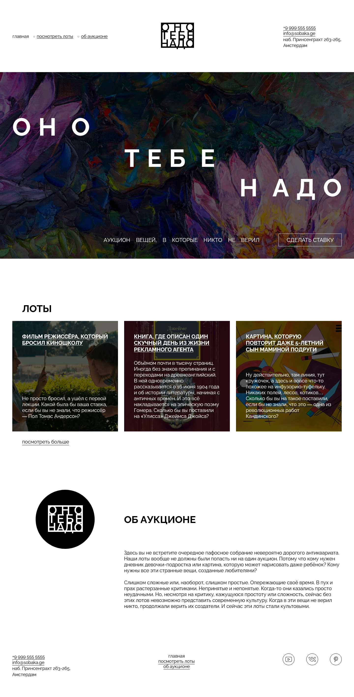

# Яндекс Практикум, 1 спринт, проект "Оно тебе надо"

## Оглавление

- [Скриншот](#скриншот)
- [Макет](#макет)
- [Ссылки](#ссылки)
- [Автор](#автор)

### Скриншот

### Макет

- Макет задания: [Figma](https://www.figma.com/file/j0GR1cSFoZbUnNWNvpDapI)

### Ссылки

- URL решения: [Github](https://github.com/SleepyMaks888/ono-tebe-nado-ad)

## Автор

- Github - [SleepyMaks888](https://github.com/SleepyMaks888)